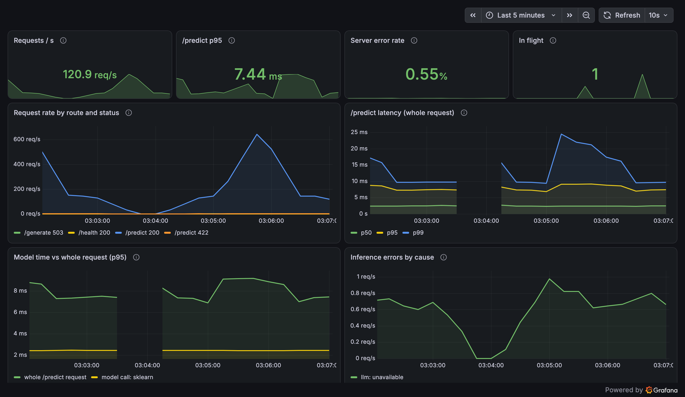
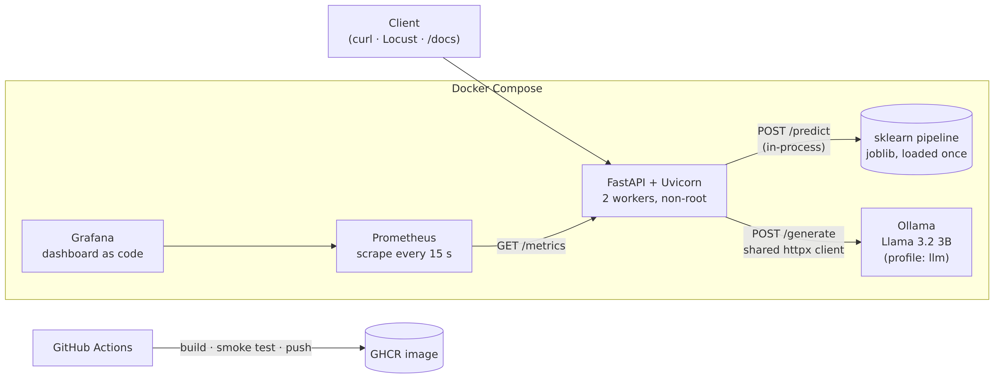

# ML Inference Service

[](https://github.com/ananthkrishh/ml-inference-service/actions/workflows/ci.yml)

A production-style REST inference API that serves a **scikit-learn customer-churn model** and a
local **Llama 3** model via **Ollama**. It's containerised with Docker, built, smoke-tested and
published by **GitHub Actions**, and instrumented with **Prometheus** latency metrics and a
**Grafana** dashboard. The metrics guided a load-test-driven optimisation.

**Stack:** Python 3.13 · FastAPI · scikit-learn · Ollama (Llama 3.2 3B) · Docker / Compose ·
GitHub Actions · GHCR · Prometheus · Grafana · Locust

### Highlights

- **2.9x throughput, 16x lower p95.** At 100 concurrent users on 2 CPUs: 318 → **929 req/s**,
  p95 280 → **17 ms**, zero errors. Each change was measured on its own ([Performance](#performance)).
- **No training/serving skew.** All preprocessing lives in the saved sklearn pipeline, and the
  `/predict` request schema is generated from the model's metadata.
- **Observable by design.** Latency histograms by route and status, model-only inference time,
  LLM tokens/s, and errors by cause. Correct across multiple worker processes.
- **CI/CD.** Lint → 42 tests → train → build → **smoke-test the real container** → push
  multi-arch (amd64 + arm64) images to GHCR. PRs never publish, and there are no long-lived secrets.



<sub>The Grafana dashboard (provisioned as code) during a Locust run with a 60-user spike. The
"Model time vs whole request" panel compares the model call (~2.5 ms) with the end-to-end request
(~7–9 ms). Inference errors are `/generate` calls made while Ollama was deliberately stopped.</sub>

---

## Architecture



<sub>Diagram source: [`docs/architecture.mmd`](docs/architecture.mmd) (Mermaid), rendered with
`mermaid-cli`.</sub>

| Endpoint | What it does |
|---|---|
| `POST /predict` | Churn probability, yes/no label and model version for one customer |
| `POST /generate` | Text from Llama 3 via Ollama (prompt, optional `max_tokens`, `temperature`) |
| `GET /health` | `ok` / `degraded` with `model_loaded`, `model_version`, `ollama_reachable` (always 200 while the API lives) |
| `GET /metrics` | Prometheus metrics, aggregated across workers |
| `GET /docs` | Interactive Swagger UI (dropdowns show the model's allowed values) |

---

## Quickstart

**Whole stack in Docker** (API, Prometheus, Grafana):

```bash
make up          # trains the model if missing, then docker compose up --build -d
make up-llm      # + Ollama; pulls llama3.2:3b (~2 GB) once into a named volume
make down
```

API <http://localhost:8000/docs> · Prometheus <http://localhost:9090> ·
Grafana <http://localhost:3000> (opens on the dashboard). Port 8000 busy? `API_PORT=8080 make up`.

**Just the published image**, no code needed:

```bash
docker run -p 8000:8000 ghcr.io/ananthkrishh/ml-inference-service:latest
```

**Local development:**

```bash
python3 -m venv .venv && source .venv/bin/activate
make install     # runtime + dev dependencies
make train       # downloads the dataset, trains, writes models/churn_model.joblib
make test        # 42 tests, Ollama mocked, no downloads
make run         # http://localhost:8000/docs
```

**Try a prediction:**

```bash
curl -s -X POST localhost:8000/predict -H 'Content-Type: application/json' -d '{
  "tenure": 2, "MonthlyCharges": 95, "gender": "Male", "SeniorCitizen": 1,
  "Partner": "No", "Dependents": "No", "PhoneService": "Yes", "MultipleLines": "No",
  "InternetService": "Fiber optic", "OnlineSecurity": "No", "OnlineBackup": "No",
  "DeviceProtection": "No", "TechSupport": "No", "StreamingTV": "Yes", "StreamingMovies": "Yes",
  "Contract": "Month-to-month", "PaperlessBilling": "Yes", "PaymentMethod": "Electronic check"}'
# {"churn_probability":0.9294,"churn":true,"model_version":"20261105210904-16320c9"}
```

---

## How it works

### Model

- **Data:** IBM Telco Customer Churn. 7,043 customers, 19 features, ~27% churn.
- **Pipeline:** `ColumnTransformer` (median-impute + scale numerics; one-hot categoricals with
  `handle_unknown="ignore"`) → classifier. Logistic regression won 5-fold stratified CV against
  histogram gradient boosting (ROC-AUC 0.846 vs 0.843), both with balanced class weights.
- **Versioned artifact:** `{pipeline, metadata}` in joblib. The metadata holds the version
  (timestamp + data hash), sklearn version, feature order, allowed category values, metrics and
  latency, and is also written as human-readable JSON.

| Held-out test set (20%) | |
|---|---|
| ROC-AUC | 0.841 |
| Recall | 0.783 |
| Precision | 0.503 |
| F1 | 0.613 |
| Single-row predict p95 (model only) | 1.1 ms |

### Serving

- The model loads **once** in the FastAPI lifespan. If it's missing, the API still starts:
  `/predict` returns 503 and `/health` reports it.
- The `CustomerFeatures` request schema is **built from model metadata** at startup (Literal
  types for categories, `ge=0` numerics, `extra="forbid"`), so the API contract can't drift from
  the model. Typos and unseen values get a precise 422.
- `/predict` is a sync endpoint, so CPU-bound inference runs in the thread pool instead of
  blocking the event loop.

### LLM (Ollama)

- One shared `httpx.AsyncClient` (connection reuse), `keep_alive` keeps the model resident, and
  a server-side `num_predict` cap bounds answer length.
- Upstream failures map to distinct codes: unreachable or model not pulled → **503**,
  timeout → **504**, bad response → **502**. The API doesn't hard-depend on Ollama, so the
  churn model keeps serving when the LLM is down.

### Observability

| Metric | Type | Labels |
|---|---|---|
| `http_request_duration_seconds` | histogram | method, **route template**, status |
| `model_inference_seconds` | histogram | model (`sklearn` / `llm`) |
| `http_requests_in_flight` | gauge (livesum) | |
| `llm_tokens_per_second`, `llm_tokens_total` | histogram, counter | kind |
| `inference_errors_total` | counter | model, reason |

A pure-ASGI middleware labels requests by **route template**, never the raw path, so
bot-probed URLs can't cause a cardinality explosion. With multiple Uvicorn workers, Prometheus
**multiprocess mode** aggregates every worker's metrics (verified by an integration test). The
Grafana datasource and dashboard are provisioned from `grafana/provisioning/`.

### CI/CD

```
lint (ruff) ─► test (pytest) ─► train model ─► build image ─► smoke test container ─► push to GHCR
```

The smoke test waits for the container's HEALTHCHECK, then calls `/health`, `/predict` and
`/metrics`, and asserts the process isn't root. Images are tagged `latest` and `sha-<commit>`,
for amd64 and arm64. Caching covers pip, the dataset and BuildKit layers (GitHub Actions cache).
PRs build and test but never publish. Publishing uses the job-scoped `GITHUB_TOKEN`.

### Container

A multi-stage build (dependencies in a builder venv; only the venv, app and model in the
runtime image) runs as non-root uid 10001 with a stdlib HEALTHCHECK. Compose pins image versions
and uses named volumes for model weights and metrics, plus resource limits.

---

## Performance

Measured with [Locust](loadtest/locustfile.py) against the Docker image (2 CPU limit, Apple M4
Pro), changing **one thing at a time**:

| Change | Load | Throughput | p50 | p95 | p99 |
|---|---|---|---|---|---|
| Baseline | 20 users | 181 req/s | 7 ms | 23 ms | 34 ms |
| + numpy array input instead of a one-row DataFrame | 20 users | 188 req/s | 4 ms | 12 ms | 17 ms |
| + 2 Uvicorn workers (Prometheus multiprocess mode) | 20 users | 191 req/s | 3 ms | **7 ms** | 10 ms |
| Baseline image | 100 users | 318 req/s | 210 ms | 280 ms | 310 ms |
| Final image | 100 users | **929 req/s** | 5 ms | **17 ms** | 29 ms |

**How the bottleneck was found:** profiling one prediction showed **81%** of the time went to
preprocessing a one-row pandas DataFrame. The classifier itself took 1.4%. Switching the
pipeline to select columns by position over a numpy object array made predictions **2.5x
faster** with **identical outputs**, proven by a parity test and the same test ROC-AUC. Under
concurrent load, Python's GIL serialises CPU work in one process, so a second worker cut tail
latency further.

**Ruled out by measurement:** Docker overhead (<1 ms when compared like for like), BLAS/OpenMP
thread counts, and CPU throttling (`cpu.stat` showed none).

**Not yet measured:** the LLM-side settings (`keep_alive`, `num_predict`) need Ollama running:
`make up-llm`, then `LOADTEST_LLM=1 make loadtest`.

```bash
pip install -r requirements-loadtest.txt
make loadtest HOST=http://localhost:8000 NAME=my-run USERS=20   # headless, 60 s
```

---

## Project layout

```
app/            FastAPI service: main.py (lifespan, docs, middleware), routes/, schemas.py,
                model.py (bundle loading + predict), ollama_client.py, metrics.py
training/       train.py: data download, cleaning, CV model selection, versioned artifact
tests/          42 pytest tests: API, schema, Ollama (respx-mocked), metrics, multiprocess
loadtest/       Locust load test + results summariser
grafana/        datasource + dashboard provisioning (as code)
prometheus/     scrape config
.github/        CI/CD workflow
Dockerfile, docker-compose.yml, Makefile
LEARNING_GUIDE.md   step-by-step walkthrough of how and why each piece was built
```

## Roadmap

- [x] Train and version the model
- [x] FastAPI `/predict` with a metadata-driven schema
- [x] Ollama `/generate` with timeout and error mapping
- [x] Prometheus metrics
- [x] Tests with mocked Ollama
- [x] Docker + Compose
- [x] GitHub Actions CI/CD to GHCR
- [x] Load test and optimise
- [x] Grafana dashboard + docs
- [ ] Measure LLM optimisations with Ollama running
- [ ] Prometheus alert rules (e.g. p95 and 5xx-rate SLOs)
